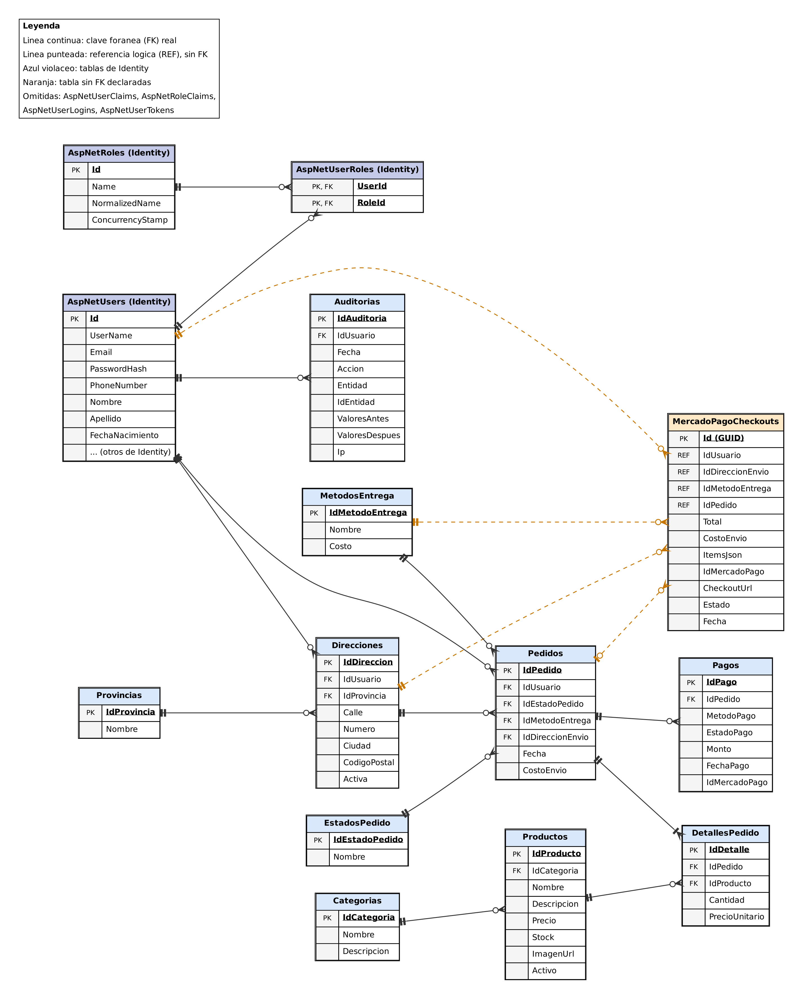

# E-COMMERCE Fuentes Facundo

Aplicación web de comercio electrónico desarrollada con **ASP.NET Core MVC (.NET 9)** para la venta de cigarrillos electrónicos y productos de vapeo. Incluye catálogo, carrito, checkout, gestión de pedidos, usuarios y roles, auditoría, reportes PDF, pago con **Mercado Pago** y un asistente virtual con **Google Gemini**.


---

## Índice

1. [Características principales](#características-principales)
2. [Stack tecnológico](#stack-tecnológico)
3. [Estructura del repositorio](#estructura-del-repositorio)
4. [Arquitectura y flujo de una petición](#arquitectura-y-flujo-de-una-petición)
5. [Modelo de datos](#modelo-de-datos)
6. [Roles y permisos](#roles-y-permisos)
7. [Flujo de compra](#flujo-de-compra)
8. [Integración con Mercado Pago](#integración-con-mercado-pago)
9. [Chatbot con Gemini](#chatbot-con-gemini)
10. [Auditoría](#auditoría)
11. [Reportes PDF](#reportes-pdf)
12. [Seguridad](#seguridad)
13. [Requisitos](#requisitos)
14. [Configuración local](#configuración-local)
15. [Tests](#tests)
16. [Endpoints principales](#endpoints-principales)
17. [Despliegue en MonsterASP](#despliegue-en-monsterasp)
18. [Solución de problemas](#solución-de-problemas)
19. [Limitaciones y mejoras posibles](#limitaciones-y-mejoras-posibles)
20. [Licencia](#licencia)

---

## Características principales

- Catálogo público con búsqueda por nombre, descripción o categoría.
- Carrusel de productos destacados en la página de inicio.
- Carrito anónimo basado en sesión.
- Checkout para usuarios autenticados con dirección y método de entrega.
- Medios de pago: **Efectivo** y **Mercado Pago**.
- Gestión administrativa de productos, categorías y métodos de entrega.
- Carga de imágenes de productos con validación de extensión y nombres únicos.
- Gestión de pedidos con transiciones de estado controladas.
- Confirmación o rechazo manual de pagos.
- Reposición automática de stock al cancelar, rechazar o reembolsar.
- Integración con **Mercado Pago Orders API** y webhook firmado con HMAC.
- Chatbot con **Google Gemini**, catálogo en tiempo real y contexto de pedidos del usuario.
- Auditoría de acciones administrativas y de cuenta.
- Reportes PDF de pedidos y comprobantes de pedido con **QuestPDF**.
- Panel responsive con modo claro/oscuro y notificaciones con SweetAlert2.

---

## Stack tecnológico

| Área | Tecnología |
|---|---|
| Framework | ASP.NET Core MVC, .NET 9 |
| Vistas | Razor (`.cshtml`) |
| ORM | Entity Framework Core 9 |
| Base de datos | SQL Server |
| Autenticación | ASP.NET Core Identity |
| Sesión | Session + Distributed Memory Cache |
| Frontend | Bootstrap 5 (tema Zephyr), Font Awesome, jQuery |
| Notificaciones | SweetAlert2 (CDN) |
| PDF | QuestPDF 2026.9.1 (licencia Community) |
| IA | Google Gemini API (`generateContent`) |
| Pagos | Mercado Pago Orders API (`v1/orders`) |
| Tests | xUnit, `WebApplicationFactory`, EF Core InMemory |
| Deploy | Web Deploy (MSDeploy/WMSVC) en MonsterASP |

---

## Estructura del repositorio

```text
E-COMMERCE-FuentesFacundo/
├─ E-COMMERCE-FuentesFacundo.slnx
├─ README.md
├─ DER_ecommerce.png
├─ E-COMMERCE-FuentesFacundo/
│  ├─ Controllers/
│  │  ├─ AccountController.cs
│  │  ├─ AuditoriasController.cs
│  │  ├─ CarritoController.cs
│  │  ├─ CategoriasController.cs
│  │  ├─ ChatController.cs
│  │  ├─ DireccionesController.cs
│  │  ├─ HomeController.cs
│  │  ├─ MercadoPagoController.cs
│  │  ├─ MetodosEntregaController.cs
│  │  ├─ PedidosAdminController.cs
│  │  ├─ PedidosController.cs
│  │  ├─ ProductosController.cs
│  │  ├─ ReportesController.cs
│  │  └─ UsuariosController.cs
│  ├─ Data/
│  │  ├─ ApplicationDbContext.cs
│  │  └─ SeedData.cs
│  ├─ Migrations/
│  ├─ Models/
│  │  ├─ Entities/
│  │  ├─ Identity/
│  │  ├─ ViewModels/
│  │  ├─ PaginatedList.cs
│  │  └─ ErrorViewModel.cs
│  ├─ Services/
│  │  ├─ AuditoriaService.cs
│  │  ├─ CartService.cs
│  │  ├─ GeminiChatService.cs
│  │  ├─ MercadoPagoService.cs
│  │  └─ PedidoReporteService.cs
│  ├─ Views/
│  │  ├─ Account/
│  │  ├─ Auditorias/
│  │  ├─ Carrito/
│  │  ├─ Categorias/
│  │  ├─ Direcciones/
│  │  ├─ Home/
│  │  ├─ MetodosEntrega/
│  │  ├─ Pedidos/
│  │  ├─ PedidosAdmin/
│  │  ├─ Productos/
│  │  ├─ Reportes/
│  │  ├─ Shared/
│  │  ├─ Usuarios/
│  │  ├─ _ViewImports.cshtml
│  │  └─ _ViewStart.cshtml
│  ├─ wwwroot/
│  │  ├─ css/
│  │  ├─ images/
│  │  ├─ js/
│  │  └─ lib/
│  ├─ Properties/
│  │  ├─ launchSettings.json
│  │  └─ PublishProfiles/
│  ├─ appsettings.json
│  ├─ appsettings.Development.json
│  ├─ E-COMMERCE-FuentesFacundo.csproj
│  └─ Program.cs
└─ E-COMMERCE-FuentesFacundo.Tests/
   ├─ AuthTests.cs
   ├─ CustomWebApplicationFactory.cs
   ├─ FakeMercadoPagoService.cs
   ├─ ProductStockTests.cs
   ├─ TestHelpers.cs
   ├─ WebhookTests.cs
   └─ E-COMMERCE-FuentesFacundo.Tests.csproj
```

> En la raíz del repositorio también existen carpetas residuales (`Data`, `Models`, `Views`, `wwwroot`) que no forman parte del proyecto web. El código que se compila y publica es el de `E-COMMERCE-FuentesFacundo/`.

---

## Arquitectura y flujo de una petición

La aplicación sigue el patrón **MVC**:

```text
Navegador
   │
   ▼
ASP.NET Core MVC (Controllers + Razor Views)
   │
   ├─ Entity Framework Core ──► SQL Server
   ├─ ASP.NET Core Identity ──► usuarios, roles y cookies
   ├─ Session ────────────────► carrito anónimo
   ├─ GeminiChatService ──────► Google Gemini API
   ├─ MercadoPagoService ─────► Mercado Pago Orders API
   └─ PedidoReporteService ───► QuestPDF
```

### Puntos importantes de `Program.cs`

- Carga opcional de un archivo `.env` desde:
  - el directorio de trabajo actual;
  - `AppContext.BaseDirectory`.
- Las variables de entorno existentes tienen prioridad; `LoadDotEnv` no las sobrescribe.
- La cadena de conexión `ConnectionStrings:DefaultConnection` es obligatoria. Se limpian comillas y saltos de línea y se valida con `SqlConnectionStringBuilder`.
- Identity usa `ApplicationUser` y `IdentityRole`.
- Política de contraseñas: mínimo 6 caracteres y al menos un dígito. No exige mayúsculas, minúsculas ni caracteres especiales.
- Cookie de login: `/Account/Login`, logout `/Account/Logout`, acceso denegado `/Account/AccessDenied`.
- Sesión con timeout de 2 horas, cookie `HttpOnly` y esencial.
- Data Protection persistente en producción en `../private/keys` respecto del content root, con nombre de aplicación y vida útil de 90 días.
- Rate limiting para el chat: 15 solicitudes por minuto, ventana fija, sin cola.
- Migraciones automáticas y seed de roles, provincias y estados de pedido al iniciar.
- `UseStaticFiles` específico para `/images/productos` (uploads en runtime).
- `MapStaticAssets()` para los assets incluidos en el manifiesto de build/publish.
- Ruta MVC por defecto: `{controller=Home}/{action=Index}/{id?}`.

---

## Modelo de datos

### Diagrama entidad-relación (DER)



### Entidades principales

| Entidad | Descripción |
|---|---|
| `ApplicationUser` | Usuario de Identity con `Nombre`, `Apellido` y `FechaNacimiento`. |
| `Provincia` | Provincia argentina usada en direcciones. |
| `Direccion` | Dirección de envío del usuario. Tiene baja lógica con `Activa`. |
| `Categoria` | Categoría de productos. Nombre único. |
| `Producto` | Producto del catálogo, con precio, stock, imagen y estado `Activo`. |
| `EstadoPedido` | Estado del pedido: `Pendiente`, `Pagado`, `Enviado`, `Entregado`, `Cancelado`. |
| `MetodoEntrega` | Método de entrega con costo. Nombre único. |
| `Pedido` | Pedido de un usuario, con estado, entrega, dirección, fecha y costo de envío. |
| `DetallePedido` | Línea del pedido con producto, cantidad y precio unitario histórico. |
| `Pago` | Pago asociado al pedido, con método, estado, monto, fecha e ID de Mercado Pago. |
| `Auditoria` | Registro de acciones con usuario, fecha, entidad, valores antes/después e IP. |
| `MercadoPagoCheckout` | Checkout pendiente de Mercado Pago con snapshot de ítems y estado. |

### Relaciones y restricciones

- `Pedido` pertenece a un `ApplicationUser`.
- `Pedido` tiene un `EstadoPedido`, un `MetodoEntrega` y una `Direccion`.
- `DetallePedido` pertenece a un `Pedido` y referencia un `Producto`.
- `Pago` pertenece a un `Pedido` y se elimina en cascada con él.
- `Direccion` pertenece a un usuario y a una provincia.
- `Auditoria` pertenece a un usuario.
- `Producto` pertenece a una categoría.
- Se evita el borrado en cascada no deseado con `DeleteBehavior.Restrict` en las relaciones sensibles.
- Los montos usan `decimal(18,2)`.
- `Categoria.Nombre` y `MetodoEntrega.Nombre` tienen índice único.

### Datos iniciales (seed)

Al iniciar se crean de forma idempotente:

- Roles: `Administrador` y `Cliente`.
- Las 24 provincias argentinas.
- Estados de pedido: `Pendiente`, `Pagado`, `Enviado`, `Entregado`, `Cancelado`.

**No** se crean usuarios administradores, productos, categorías ni métodos de entrega por defecto.

### Cómo crear el primer administrador

1. Registrar un usuario desde `/Account/Register`.
2. Asignarle el rol `Administrador` directamente en la base de datos:

```sql
INSERT INTO AspNetUserRoles (UserId, RoleId)
SELECT u.Id, r.Id
FROM AspNetUsers u
CROSS JOIN AspNetRoles r
WHERE u.Email = 'correo@ejemplo.com'
  AND r.Name = 'Administrador';
```

3. Iniciar sesión nuevamente. El menú de administración aparecerá en la barra lateral.

---

## Roles y permisos

### Anónimo

- Ver catálogo y buscar productos.
- Ver detalles de producto.
- Agregar, actualizar y quitar productos del carrito.
- Registrarse e iniciar sesión.
- Usar el chatbot.

### Cliente

- Todo lo anterior.
- Checkout y creación de pedidos.
- Ver sus propios pedidos.
- Descargar el comprobante PDF de sus pedidos.
- Gestionar sus direcciones (crear, editar, desactivar y reactivar).
- Editar su perfil y cambiar su contraseña.

### Administrador

- Gestionar productos (crear, editar, eliminar y cargar imágenes).
- Gestionar categorías.
- Gestionar métodos de entrega.
- Ver todos los pedidos, filtrarlos y cambiar su estado.
- Confirmar o rechazar pagos.
- Gestionar usuarios y roles.
- Restablecer contraseñas de usuarios.
- Consultar la auditoría.
- Generar reportes PDF de pedidos.
- Ver detalles y comprobantes de cualquier pedido.

> Un administrador no puede quitarse a sí mismo el rol `Administrador` ni dejar el sistema sin ningún administrador.

---

## Flujo de compra

### 1. Catálogo y carrito

- La página de inicio muestra solo productos `Activo`.
- La búsqueda filtra por nombre, descripción o categoría y limita el texto a 100 caracteres.
- El carrito se guarda en sesión como JSON, con líneas `{ IdProducto, Cantidad }`.
- Al agregar un producto se valida que exista, esté activo y tenga stock suficiente.
- El carrito es anónimo; el checkout requiere autenticación.

### 2. Checkout

El checkout requiere:

- Usuario autenticado.
- Carrito con al menos un producto.
- Dirección activa del usuario.
- Método de entrega válido.
- Medio de pago válido: `Efectivo` o `Mercado Pago`.

Antes de crear el pedido se vuelven a validar:

- Existencia y estado activo de los productos.
- Stock suficiente.
- Pertenencia y estado activo de la dirección.
- Existencia del método de entrega.

### 3. Pago en efectivo

- Se crea un `Pedido` en estado `Pendiente`.
- Se crea un `Pago` en estado `Pendiente`.
- El stock se descuenta inmediatamente.
- El carrito se vacía.
- El usuario es redirigido al detalle del pedido.
- El administrador debe confirmar o rechazar el pago manualmente.

Si el pago es por transferencia QR (solo pedidos históricos) y está pendiente, el comprobante PDF incluye la imagen `wwwroot/images/qr-transferencia.png` si el archivo existe.

### 4. Pago con Mercado Pago

- Se crea un registro `MercadoPagoCheckout` con:
  - usuario;
  - dirección;
  - método de entrega;
  - total y costo de envío;
  - snapshot de ítems en `ItemsJson`;
  - estado inicial `Pendiente`.
- Se llama a Mercado Pago Orders API para crear la orden.
- Se guardan `IdMercadoPago` y `CheckoutUrl`.
- El usuario es redirigido a una pantalla con el enlace de pago.
- **El pedido no se crea todavía.** Se crea recién cuando Mercado Pago confirma el pago.
- **El stock no se reserva al iniciar el checkout.** Se valida y descuenta al aprobarse el pago.
- Si el pago se aprueba, el checkout se convierte en:
  - `Pedido` en estado `Pagado`;
  - `Pago` en estado `Aprobado`;
  - descuento de stock;
  - checkout en estado `Convertido`.
- El carrito se vacía cuando la pantalla de seguimiento consulta `/api/mercadopago/checkout/{id}/estado` y detecta que el checkout fue convertido.
- Si el pago se rechaza, cancela, reembolsa o expira, el checkout se actualiza y el carrito permanece disponible.
- Si al convertir el checkout ya no hay stock suficiente, el checkout queda en estado `Fallido`.

### 5. Estados del pedido

```text
Pendiente ──► Pagado ──► Enviado ──► Entregado
     │            │
     └────────────┴──────► Cancelado
```

Transiciones permitidas:

| Estado actual | Estados siguientes |
|---|---|
| `Pendiente` | `Pagado`, `Cancelado` |
| `Pagado` | `Enviado`, `Cancelado` |
| `Enviado` | `Entregado` |
| `Entregado` | Ninguno |
| `Cancelado` | Ninguno |

- Al cancelar un pedido se repone el stock.
- Al rechazar un pago se cancela el pedido y se repone el stock.
- Al confirmar un pago pendiente, el pedido pasa a `Pagado`.

### 6. Estados del checkout de Mercado Pago

| Estado | Significado |
|---|---|
| `Pendiente` | Checkout creado, pago aún no confirmado. |
| `Convertido` | Pago aprobado y pedido creado. |
| `Fallido` | No se pudo convertir por falta de stock, producto inexistente u otro error. |
| `Rechazado` | Pago rechazado. |
| `Cancelado` | Orden cancelada. |
| `Reembolsado` | Pago reembolsado. |
| `Expirado` | Orden expirada. |

---

## Integración con Mercado Pago

### API utilizada

Se usa **Orders API** (`POST v1/orders`), no Preferences.

La creación de la orden envía:

- `type`: `online`
- `processing_mode`: `manual`
- `capture_mode`: `automatic_async`
- `total_amount`
- `external_reference`: ID del `MercadoPagoCheckout` (GUID)
- `description`
- `expiration_time`: `P1D`
- `payer.email`
- `items` con título, cantidad y precio unitario
- `config.online` con `success_url`, `failure_url`, `pending_url` y `auto_return = all`

Headers:

- `Authorization: Bearer <AccessToken>`
- `X-Idempotency-Key: <GUID>`

La respuesta debe incluir:

- `id`: ID de la orden en Mercado Pago.
- `checkout_url`: URL a la que se redirige al usuario.

### Configuración

En `appsettings.json`:

```json
"MercadoPago": {
  "BaseUrl": "https://api.mercadopago.com/",
  "AccessToken": "",
  "WebhookSecret": "",
  "Environment": "Sandbox"
}
```

| Clave | Uso |
|---|---|
| `MercadoPago:AccessToken` | Token de acceso. Sin él, el checkout con Mercado Pago devuelve error 503. |
| `MercadoPago:WebhookSecret` | Secreto para validar la firma HMAC del webhook. Sin él, el webhook devuelve 401. |
| `MercadoPago:BaseUrl` | URL base de la API. Por defecto `https://api.mercadopago.com/`. |
| `MercadoPago:Environment` | Se lee, pero **no se usa** en el código. El entorno lo determina el token. |

### Endpoints

| Método | Ruta | Autorización | Descripción |
|---|---|---|---|
| GET | `/api/mercadopago/success` | Autenticado | Retorno de pago aprobado. |
| GET | `/api/mercadopago/failure` | Autenticado | Retorno de pago rechazado o cancelado. |
| GET | `/api/mercadopago/pending` | Autenticado | Retorno de pago pendiente. |
| GET | `/api/mercadopago/checkout/{checkoutId}/estado` | Autenticado, dueño | Consulta y sincroniza el estado de un checkout. |
| GET | `/api/mercadopago/estado/{pedidoId}` | Autenticado, dueño o admin | Consulta y sincroniza el pago de un pedido. |
| POST | `/api/mercadopago/webhook` | Anónimo | Recibe notificaciones de Mercado Pago. |

### Webhook

El webhook:

1. Lee `data.id` desde la query string o desde el body JSON.
2. Si no hay `data.id`, responde `200`.
3. Exige `MercadoPago:WebhookSecret`. Si falta, responde `401`.
4. Valida la firma con los headers `x-signature` y `x-request-id`.
5. Busca el checkout por `IdMercadoPago` o por `external_reference`.
6. Consulta la orden en Mercado Pago.
7. Si el pago está aprobado, convierte el checkout en pedido.
8. Si no, actualiza el estado del checkout.
9. Si el checkout es desconocido, responde `200`.

Manifiesto de firma:

```text
id:{dataId};request-id:{xRequestId};ts:{timestamp};
```

Se calcula HMAC-SHA256 con el secreto y se compara en tiempo constante.

> El webhook está pensado para notificaciones de **Orders API**: el `data.id` recibido debe ser el ID de la orden de Mercado Pago. Configurá la URL de notificación apuntando a:
>
> `https://<tu-dominio>/api/mercadopago/webhook`

### Variables de entorno

En MonsterASP o en cualquier entorno con variables de entorno, usar los nombres estándar de ASP.NET Core:

```text
MercadoPago__AccessToken=...
MercadoPago__WebhookSecret=...
MercadoPago__BaseUrl=https://api.mercadopago.com/
```

En un archivo `.env` también se aceptan alias:

```text
MP_ACCESS_TOKEN=...
MP_WEBHOOK_SECRET=...
MP_BASE_URL=https://api.mercadopago.com/
MP_ENVIRONMENT=Sandbox
```

> Los alias `MP_*` solo se traducen cuando se cargan desde `.env`. Si se cargan directamente como variables de entorno del sistema o del panel, usar los nombres con `MercadoPago__...`.

---

## Chatbot con Gemini

### Funcionamiento

- El chatbot aparece como un botón flotante en todas las páginas.
- El historial se guarda en `sessionStorage` y se limitan los últimos 12 mensajes.
- Al enviar un mensaje se hace `POST /api/chat` con:

```json
{
  "messages": [
    { "role": "user", "content": "¿Tienen productos con stock?" }
  ]
}
```

- La respuesta tiene el formato:

```json
{
  "reply": "Texto de respuesta",
  "model": "gemini-3.6-flash"
}
```

- El endpoint es anónimo, pero si el usuario está autenticado se incluyen sus últimos 5 pedidos como contexto.
- El catálogo se obtiene de productos activos, máximo 80, y se cachea 60 segundos.
- El prompt indica que no invente productos, precios ni stock, que no dé consejos médicos y que no procese pedidos, pagos ni cambios de cuenta.
- El límite de uso es de 15 solicitudes por minuto por ventana fija.

### Configuración

```json
"Gemini": {
  "ApiKey": "",
  "Model": "gemini-3.6-flash",
  "BaseUrl": "https://generativelanguage.googleapis.com/v1beta/",
  "MaxOutputTokens": 512,
  "Temperature": 0.4,
  "TimeoutSeconds": 30,
  "MaxInputChars": 1000,
  "MaxHistoryMessages": 12,
  "MaxCatalogProducts": 80
}
```

| Clave | Uso |
|---|---|
| `Gemini:ApiKey` | API key. Sin ella, el chat responde 503. |
| `Gemini:Model` | Modelo de Gemini. |
| `Gemini:BaseUrl` | URL base de la API. |
| `Gemini:MaxOutputTokens` | Máximo de tokens de salida. |
| `Gemini:Temperature` | Temperatura de generación. |
| `Gemini:TimeoutSeconds` | Timeout de la llamada. |
| `Gemini:MaxInputChars` | Máximo de caracteres por mensaje. |
| `Gemini:MaxHistoryMessages` | Máximo de mensajes de historial enviados. |
| `Gemini:MaxCatalogProducts` | Máximo de productos incluidos en el prompt. |

La API key se envía en el header `x-goog-api-key`.

### Variables de entorno

En MonsterASP o en variables del sistema:

```text
Gemini__ApiKey=...
Gemini__Model=gemini-3.6-flash
```

En `.env` se aceptan alias:

```text
GEMINI_API_KEY=...
GEMINI_MODEL=gemini-3.6-flash
```

> Importante: en MonsterASP, `GEMINI_API_KEY` **no** llena `Gemini:ApiKey`. El mapeo de alias solo ocurre al leer `.env`. En el panel usar `Gemini__ApiKey`.

### Errores comunes

| Situación | Respuesta |
|---|---|
| Falta `Gemini:ApiKey` | `503` con mensaje de chat no configurado. |
| Gemini devuelve error HTTP | `502`. |
| La respuesta no se puede interpretar | `502`. |
| El prompt fue bloqueado | `400`. |
| Se supera el límite de 15/min | `429`. |
| La consulta tarda demasiado | `408`. |

---

## Auditoría

El servicio `AuditoriaService` registra acciones de usuarios autenticados con:

- Usuario.
- Fecha.
- Acción.
- Entidad.
- ID de entidad.
- Valores antes y después en JSON.
- IP remota.

Se auditan, entre otras acciones:

- Crear, editar y eliminar productos.
- Crear, editar y eliminar categorías.
- Crear, editar y eliminar métodos de entrega.
- Crear pedidos.
- Cambiar estado de pedidos.
- Confirmar o rechazar pagos.
- Sincronizaciones de Mercado Pago.
- Crear checkouts de Mercado Pago.
- Cambiar roles de usuarios.
- Restablecer contraseñas.
- Cambiar la contraseña propia.

La auditoría no debe interrumpir la operación principal: si falla el registro, se escribe una advertencia en el log y la acción continúa.

El panel de auditoría permite filtrar por usuario, entidad, acción y rango de fechas, y ver el detalle con el JSON formateado.

---

## Reportes PDF

Se usa **QuestPDF** con licencia Community.

### Listado de pedidos

- Ruta: `/Reportes/Pedidos`.
- Filtros: fecha desde, fecha hasta y estado.
- Descarga: `/Reportes/DescargarPedidosPdf`.
- Incluye cliente, estado, entrega, pago y total por pedido, más un total general.

### Comprobante de pedido

- Ruta: `/Pedidos/Comprobante/{id}`.
- Accesible para el dueño del pedido o un administrador.
- Incluye datos del cliente, dirección, productos, subtotal, envío, total y pago.
- Si el pago es `Transferencia por QR` (solo pedidos históricos) y está pendiente, intenta incluir la imagen `wwwroot/images/qr-transferencia.png`.

> Esa imagen no está incluida en el repositorio. Si no existe, el comprobante se genera igualmente sin el QR.

---

## Seguridad

- Autenticación y autorización con ASP.NET Core Identity.
- Roles `Administrador` y `Cliente`.
- Email único por usuario.
- Contraseñas con mínimo 6 caracteres y al menos un dígito.
- Formularios POST protegidos con antiforgery token.
- Validación de pertenencia en pedidos, direcciones y checkouts.
- El webhook de Mercado Pago valida firma HMAC-SHA256 en tiempo constante.
- Carga de imágenes:
  - extensiones permitidas: `.jpg`, `.jpeg`, `.png`, `.gif`, `.webp`;
  - nombre generado con GUID;
  - borrado limitado a la carpeta `/images/productos/`;
  - protección contra path traversal.
- Los productos con pedidos asociados no se pueden eliminar.
- Las categorías con productos y los métodos de entrega con pedidos no se pueden eliminar.
- Secretos por variables de entorno o `.env`; `.env` está excluido por `.gitignore`.
- Data Protection persistente en producción para que las cookies sobrevivan reinicios.
- Rate limiting en el chatbot.
- HTTPS redirection y HSTS en producción.

### Consideraciones

- No hay confirmación de email ni recuperación de contraseña por correo.
- No hay bloqueo por intentos fallidos (`lockoutOnFailure: false`).
- No hay 2FA.
- No hay límite de tamaño ni análisis de contenido real para las imágenes subidas.
- No se configuró `UseForwardedHeaders`; si se despliega detrás de un proxy inverso, revisar el esquema y la IP real.
- El webhook valida firma, pero no aplica una ventana de tolerancia temporal explícita.
- No hay Content Security Policy ni cabeceras de seguridad adicionales.

---

## Requisitos

- .NET 9 SDK.
- SQL Server (LocalDB, Express o completo) o una instancia accesible.
- Visual Studio 2022 actualizado o VS Code.
- Opcional: API key de Google Gemini para el chatbot.
- Opcional: credenciales de Mercado Pago para pagos online.
- PowerShell 7 o terminal equivalente.

---

## Configuración local

### 1. Restaurar dependencias

```powershell
dotnet restore
```

### 2. Crear el archivo `.env`

Colocarlo en la carpeta del proyecto web:

```text
E-COMMERCE-FuentesFacundo/.env
```

Ejemplo:

```dotenv
ConnectionStrings__DefaultConnection=Server=localhost;Database=EcommerceFuentesFacundo;Trusted_Connection=True;TrustServerCertificate=True;

Gemini__ApiKey=tu_api_key_de_gemini
Gemini__Model=gemini-3.6-flash

MercadoPago__AccessToken=tu_access_token
MercadoPago__WebhookSecret=tu_webhook_secret
MercadoPago__BaseUrl=https://api.mercadopago.com/
```

También se pueden usar los alias:

```dotenv
GEMINI_API_KEY=tu_api_key_de_gemini
MP_ACCESS_TOKEN=tu_access_token
MP_WEBHOOK_SECRET=tu_webhook_secret
```

> `LoadDotEnv` ignora líneas vacías y comentarios que empiezan con `#`, recorta comillas externas y no sobrescribe variables de entorno ya existentes.

### 3. Ejecutar la aplicación

Desde la carpeta del proyecto web:

```powershell
cd E-COMMERCE-FuentesFacundo
dotnet run
```

O desde la raíz del repositorio:

```powershell
dotnet run --project E-COMMERCE-FuentesFacundo/E-COMMERCE-FuentesFacundo.csproj
```

URLs de desarrollo:

- HTTP: `http://localhost:5062`
- HTTPS: `https://localhost:7127`

> Si ejecutás desde la raíz con `--project`, asegurate de que `.env` esté en el directorio de trabajo o definí las variables de entorno del sistema.

### 4. Base de datos

Al iniciar la aplicación:

- Se aplican las migraciones pendientes con `Database.MigrateAsync()`.
- Se crean roles, provincias y estados de pedido si no existen.

La base debe existir o el usuario de SQL Server debe tener permisos para crearla.

### 5. Primer uso

1. Registrarse en `/Account/Register`.
2. Asignar el rol `Administrador` al primer usuario (ver sección [Modelo de datos](#modelo-de-datos)).
3. Iniciar sesión.
4. Crear categorías y métodos de entrega desde el panel.
5. Crear productos y subir imágenes.
6. Configurar Gemini y Mercado Pago si se van a usar.

---

## Tests

El proyecto de tests usa:

- xUnit.
- `WebApplicationFactory<Program>`.
- EF Core InMemory.
- Un `FakeMercadoPagoService` que simula una orden aprobada.
- Un administrador de prueba: `facu.fuentez@gmail.com` / `facuadmin11`.

> Esas credenciales son solo para el entorno de tests. No usarlas en producción.

Cobertura actual: **9 tests**.

- `AuthTests` (5):
  - Login GET.
  - Login con credenciales válidas.
  - Login con credenciales inválidas.
  - Anónimo no accede a productos de administración.
  - Cliente autenticado no accede a pedidos de administración.
- `ProductStockTests` (2):
  - Validación de precio y stock negativos.
  - Checkout en efectivo descuenta stock.
- `WebhookTests` (2):
  - Webhook con firma válida convierte checkout y crea pedido.
  - Webhook con firma inválida devuelve 401.

Ejecutar:

```powershell
dotnet test E-COMMERCE-FuentesFacundo.Tests/E-COMMERCE-FuentesFacundo.Tests.csproj -c Release
```

Compilar la solución web:

```powershell
dotnet build E-COMMERCE-FuentesFacundo.slnx -c Release
```

---

## Endpoints principales

### Públicos

| Ruta | Descripción |
|---|---|
| `/` | Catálogo y búsqueda. |
| `/Home/Privacy` | Página de privacidad. |
| `/Productos/Details/{id}` | Detalle de producto. |
| `/Carrito` | Carrito. |
| `/Account/Login` | Inicio de sesión. |
| `/Account/Register` | Registro. |
| `/api/chat` | Chatbot. |

### Autenticados

| Ruta | Descripción |
|---|---|
| `/Carrito/Checkout` | Checkout. |
| `/Carrito/MercadoPagoCheckout` | Pantalla con enlace de pago de Mercado Pago. |
| `/Pedidos` | Mis pedidos. |
| `/Pedidos/Details/{id}` | Detalle de pedido propio. |
| `/Pedidos/Comprobante/{id}` | Comprobante PDF propio. |
| `/Direcciones` | Mis direcciones. |
| `/Account/Profile` | Mi perfil. |
| `/Account/ChangePassword` | Cambiar contraseña. |

### Administración

| Ruta | Descripción |
|---|---|
| `/Productos` | Listado administrativo de productos. |
| `/Productos/Create` | Crear producto. |
| `/Productos/Edit/{id}` | Editar producto. |
| `/Productos/Delete/{id}` | Eliminar producto. |
| `/Categorias` | Gestión de categorías. |
| `/MetodosEntrega` | Gestión de métodos de entrega. |
| `/PedidosAdmin` | Gestión de pedidos. |
| `/PedidosAdmin/Details/{id}` | Detalle administrativo de pedido. |
| `/Usuarios` | Gestión de usuarios. |
| `/Usuarios/Edit/{id}` | Editar roles. |
| `/Usuarios/ResetPassword/{id}` | Restablecer contraseña. |
| `/Auditorias` | Auditoría. |
| `/Auditorias/Details/{id}` | Detalle de auditoría. |
| `/Reportes/Pedidos` | Reporte de pedidos. |
| `/Reportes/DescargarPedidosPdf` | Descarga del reporte PDF. |

### API de Mercado Pago

| Método | Ruta | Autorización |
|---|---|---|
| GET | `/api/mercadopago/success` | Autenticado |
| GET | `/api/mercadopago/failure` | Autenticado |
| GET | `/api/mercadopago/pending` | Autenticado |
| GET | `/api/mercadopago/checkout/{checkoutId}/estado` | Autenticado, dueño |
| GET | `/api/mercadopago/estado/{pedidoId}` | Autenticado, dueño o admin |
| POST | `/api/mercadopago/webhook` | Anónimo |

---

## Despliegue en MonsterASP

### Perfil de publicación

El proyecto incluye dos perfiles idénticos:

- `Properties/PublishProfiles/site106890-WebDeploy.pubxml`
- `Properties/PublishProfiles/site106890-WebDeploy1.pubxml`

Datos principales:

| Propiedad | Valor |
|---|---|
| Sitio | `site106890` |
| URL | `http://ecommercefuentesfacundo.runasp.net/` |
| Método | Web Deploy (MSDeploy/WMSVC) |
| Servidor | `site106890.siteasp.net` |
| `SkipExtraFilesOnServer` | `true` |
| `EnableMSDeployBackup` | `true` |
| `EnableMsDeployAppOffline` | `true` |

`SkipExtraFilesOnServer=true` evita que el deploy elimine archivos que no están en la publicación local, como las imágenes subidas en runtime.

### Estructura en el servidor

En MonsterASP:

- El **content root** se llama `wwwroot` y contiene `.dll`, `web.config` y `appsettings.json`.
- La **web root real** es `wwwroot\wwwroot`, con `css`, `js`, `lib`, `images` y `favicon.ico`.
- Las imágenes de productos se guardan en `wwwroot\wwwroot\images\productos`.

### Variables de entorno en MonsterASP

Configurar en el panel del sitio:

```text
ConnectionStrings__DefaultConnection=...
Gemini__ApiKey=...
Gemini__Model=gemini-3.6-flash
MercadoPago__AccessToken=...
MercadoPago__WebhookSecret=...
MercadoPago__BaseUrl=https://api.mercadopago.com/
```

Importante:

- Usar `__` (doble guion bajo) para representar `:` en la configuración.
- **No** usar `GEMINI_API_KEY` en el panel: ese alias solo se traduce desde `.env`. En el panel debe ser `Gemini__ApiKey`.
- **No** usar `MP_ACCESS_TOKEN` en el panel: debe ser `MercadoPago__AccessToken`.
- `MercadoPago__Environment` no se usa; el entorno lo define el token.
- Después de cambiar variables, reiniciar la aplicación desde el panel.

### Imágenes subidas en runtime

`MapStaticAssets()` sirve los archivos incluidos en el manifiesto de build/publish. Las imágenes subidas después del deploy no están en ese manifiesto, por eso se agregó un middleware específico:

```csharp
app.UseStaticFiles(new StaticFileOptions
{
    FileProvider = new PhysicalFileProvider(
        Path.Combine(app.Environment.WebRootPath, "images", "productos")),
    RequestPath = "/images/productos"
});
```

Esto permite servir `/images/productos/<archivo>` aunque el archivo se haya subido en runtime.

Requisitos:

- La carpeta `wwwroot\wwwroot\images\productos` debe existir o poder crearse.
- El usuario de la aplicación debe tener permisos de escritura.
- Si se agregan otras carpetas de uploads en runtime, hay que mapearlas de forma similar.

### Data Protection

En producción se guardan las claves en:

```text
../private/keys
```

respecto del content root. En MonsterASP esto queda fuera de la web root. Verificar que la carpeta sea escribible y persista entre reinicios.

Si la configuración falla, la aplicación escribe un mensaje en consola y continúa; en ese caso las cookies de autenticación y sesión podrían no sobrevivir reinicios.

### Base de datos y migraciones

- Las migraciones se aplican automáticamente al iniciar.
- Hacer backup antes de publicar cambios que incluyan migraciones.
- La cadena de conexión debe ser válida y el usuario debe tener permisos suficientes.
- Si la contraseña contiene `;`, revisar el escape y las comillas.

### Publicación

Desde Visual Studio:

1. Clic derecho en el proyecto web.
2. **Publicar**.
3. Seleccionar el perfil `site106890-WebDeploy`.
4. Publicar.

También se puede publicar a una carpeta:

```powershell
dotnet publish E-COMMERCE-FuentesFacundo/E-COMMERCE-FuentesFacundo.csproj -c Release
```

Luego subir el contenido de `bin/Release/net9.0/publish` por el mecanismo disponible en MonsterASP.

> No compartir ni commitear los archivos `.pubxml.user`, que pueden contener credenciales de publicación.

### URL del webhook

Configurar en Mercado Pago:

```text
https://ecommercefuentesfacundo.runasp.net/api/mercadopago/webhook
```

Usar HTTPS y verificar que el sitio tenga SSL configurado.

---

## Solución de problemas

| Problema | Causa probable | Solución |
|---|---|---|
| Error al iniciar por cadena de conexión | Falta `ConnectionStrings__DefaultConnection` o es inválida. | Configurarla con el nombre correcto. Revisar comillas, saltos de línea y `;` en la contraseña. |
| El chat responde 503 “no configurado” | Falta `Gemini:ApiKey`. | En MonsterASP usar `Gemini__ApiKey`, no `GEMINI_API_KEY`. Reiniciar la aplicación. |
| El chat responde 502 | Error de Gemini, modelo inexistente, cuota o red. | Revisar logs, API key y `Gemini__Model`. |
| El chat responde 429 | Se superó el límite de 15 solicitudes por minuto. | Esperar y reintentar. |
| Las imágenes subidas dan 404 | No se está sirviendo la carpeta de uploads o no hay permisos. | Verificar `UseStaticFiles` para `/images/productos`, la ruta `wwwroot\wwwroot\images\productos` y los permisos de escritura. |
| Las imágenes desaparecen después de publicar | El deploy borró archivos extra. | Mantener `SkipExtraFilesOnServer=true` y hacer backup. |
| Mercado Pago responde 503 | Falta `MercadoPago:AccessToken`. | Configurar `MercadoPago__AccessToken` y reiniciar. |
| El webhook responde 401 | Falta `MercadoPago:WebhookSecret`, el secreto es incorrecto o la firma no coincide. | Configurar el secreto correcto y verificar la URL y los headers. |
| El pago se aprueba pero no se crea el pedido | Webhook no configurado, URL inaccesible o notificación con un ID que no es de Orders API. | Configurar el webhook de órdenes, revisar logs y consultar `/api/mercadopago/checkout/{id}/estado`. |
| El checkout queda `Fallido` | Producto eliminado o stock insuficiente al aprobar el pago. | Revisar stock y pedir al usuario que reintente. |
| El usuario pierde la sesión al reiniciar | Data Protection no persiste las claves. | Verificar permisos y persistencia de `../private/keys`. |
| Un usuario no ve el menú de administración | No tiene el rol `Administrador`. | Asignar el rol en la tabla `AspNetUserRoles` o desde `/Usuarios` con otro admin. |
| `.env` no se carga | El archivo no está en el directorio de trabajo ni en `AppContext.BaseDirectory`. | Ejecutar desde la carpeta del proyecto o definir variables de entorno. |
| El reporte PDF no muestra el QR (pedidos históricos) | No existe `wwwroot/images/qr-transferencia.png`. | Agregar la imagen si se quiere incluir el QR. |
| Error de migración al iniciar | Base inexistente, permisos insuficientes o connection string incorrecta. | Crear la base o corregir permisos/credenciales. |
| Las cookies no funcionan detrás de un proxy | No hay `UseForwardedHeaders`. | Configurar forwarded headers si corresponde. |

---

## Limitaciones y mejoras posibles

- El carrito vive en sesión en memoria: se pierde al reiniciar la aplicación y no se comparte entre instancias.
- Data Protection usa archivos locales; para varias instancias hace falta almacenamiento compartido.
- No hay confirmación de email ni recuperación de contraseña por correo.
- No hay bloqueo por intentos fallidos ni 2FA.
- No se reserva stock al iniciar un checkout de Mercado Pago; se valida al aprobar.
- El webhook de Mercado Pago no aplica tolerancia temporal explícita a la firma.
- No se validan firmas de archivos de imagen ni se limita su tamaño.
- Los detalles de producto son públicos y no filtran por `Activo`; el catálogo sí lo hace.
- No se auditan todas las acciones (por ejemplo, login, registro o cambios de direcciones).
- No hay CI/CD ni pipeline automatizado de build, tests y deploy.
- No hay seed de productos, categorías ni métodos de entrega.
- No hay integración de reembolsos desde la aplicación; solo se sincroniza el estado.
- No hay localización; los textos están en español y los reportes PDF usan formato `es-AR`.
- `MercadoPago:Environment` está en configuración pero no se utiliza.
- La solución `.slnx` no incluye el proyecto de tests; hay que ejecutarlo por separado.
- Las credenciales de publicación pueden quedar en archivos `.pubxml.user`; no deben compartirse.

---

## Licencia

Proyecto personal/académico de Facundo Fuentes. No se incluye un archivo de licencia explícito. Si se va a reutilizar o distribuir, agregar la licencia correspondiente.
